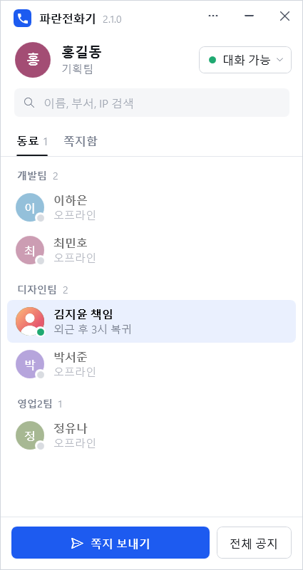
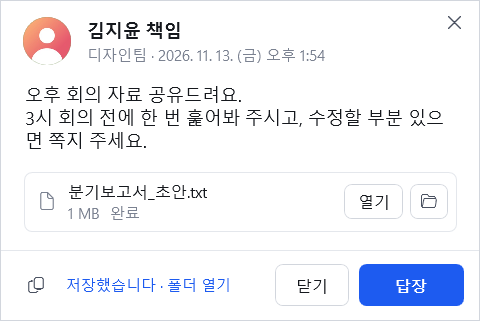
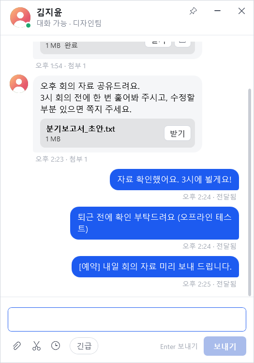
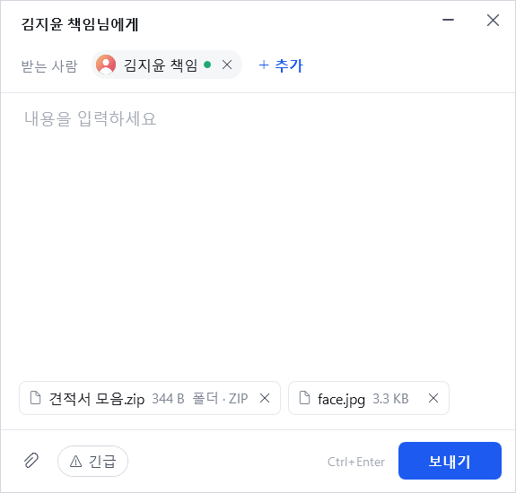
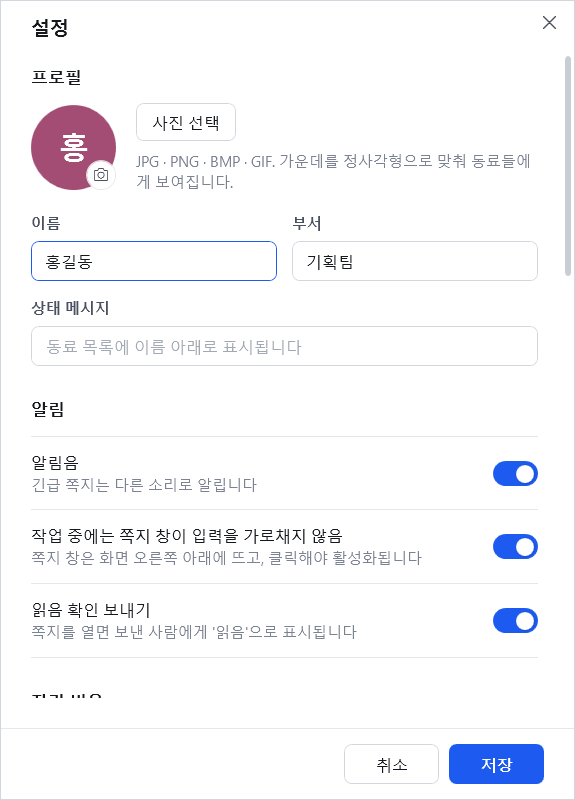

<p align="center"></p>

<h1 align="center">파란전화기</h1>

<p align="center">서버 없이 같은 사내 네트워크에서 바로 쓰는 팝업 쪽지 메신저<br>
2007년의 "빨간전화기 X-PopUp" 감성을 지금 Windows에 맞게 다시 만든 프로그램입니다.</p>

<p align="center">
  <a href="../../releases/latest"><b>최신 버전 내려받기</b></a> ·
  <a href="CHANGELOG.md">변경 이력</a>
</p>

<p align="center">
  
  
</p>

## 특징

- **설치 없음** — 실행 파일 하나(약 270 KB). Windows 10/11에 기본으로 들어 있는 .NET Framework 4.8로 동작합니다.
- **서버 없음** — 같은 네트워크의 PC를 자동으로 찾습니다. 라우터 너머 다른 대역은 IP를 직접 등록하면 됩니다.
- **파일 이름을 마음대로** — `파란전화기.exe`, `사내쪽지.exe` 무엇으로 바꿔도 실행되고, 작업 관리자에도 바꾼 이름으로 표시됩니다.
- **자동 업데이트** — 이 저장소에 새 버전이 올라오면 프로그램이 받아 두고 변경 사항과 함께 알려 줍니다.
- **암호화 통신** — 연결마다 새 키(ECDH P-256)를 만들어 AES-256으로 암호화하고 HMAC-SHA256으로 변조를 검사합니다.

## 기능

| 구분 | 내용 |
|---|---|
| 동료 목록 | 자동 검색, 부서별 묶음, 상태(대화 가능·다른 용무 중·자리 비움·방해 금지), 상태 메시지, 프로필 사진, 내가 붙이는 별명 |
| 쪽지 | 1:1 · 여러 명 · 전체 공지 · 그룹, 긴급 쪽지(방해 금지 무시, 창 깜박임, 별도 알림음), 읽음 확인 |
| 대화 창 | 동료 더블클릭 → 말풍선 1:1 대화, Enter로 보내기, 대화 중에는 팝업 없이 바로 읽음, 테마 15종 · 글꼴 · 글자 크기 변경 |
| 쪽지함 · 대화함 | 쪽지와 1:1 대화를 따로 보관 · 읽음 처리 · 삭제, 탭별 안 읽은 개수 |
| 마크다운 · 코드 | 대화 · 쪽지에서 굵게/기울임/목록/인용/링크, 코드 블록(언어 표시 · 복사 버튼), 서식 · 코드 버튼과 단축키 |
| 이미지 바로 보기 | 받은 이미지 자동 표시, GIF 재생, 스크린샷 붙여 넣기 미리 보기, 이미지 · 텍스트 · 동영상 미리 보기 창 |
| 차단 | 동료 차단 시 목록에서 숨기고 쪽지 · 대화 수신 안 함, ⋯ 메뉴에서 해제 |
| 이모지 | 컬러 이모지 66종 + 텍스트 이모티콘, 이모지만 보내면 크게 표시 |
| 오프라인 보관 | 상대가 꺼져 있으면 '대기 중'으로 보관, 접속하는 순간 자동 전달 (최대 7일) |
| 예약 · 다시 알림 | 30분 뒤 · 1시간 뒤 · 오늘 6시 · 내일 9시 · 직접 지정으로 예약 발송, 받은 쪽지를 나중에 다시 띄우기 |
| 화면 캡처 | 어디서든 Ctrl+Alt+S → 영역 드래그 → 대화 창 / 새 쪽지에 바로 첨부 |
| 즐겨찾기 · 그룹 | 즐겨찾기는 목록 맨 위 고정, 그룹으로 목록 거르기 · 그룹 전체에 쪽지 |
| 받은 쪽지 창 | 화면 오른쪽 아래부터 위로 쌓임, 작업 중 입력을 가로채지 않음, 창 안에서 바로 답장(Ctrl+Enter), 10초·30초·1분 뒤 자동 닫기, 대화 창·쪽지함에서 읽으면 함께 닫힘 |
| 알림 개인정보 보호 | 알림에 보낸 사람·내용 모두 표시 / 보낸 사람만 표시(기본) / 모두 숨기기 — 가려진 알림은 눌러야 보임 |
| 첨부 | 모든 형식의 파일, 폴더는 자동으로 ZIP 압축, 끌어다 놓기, 캡처 이미지 Ctrl+V |
| 받은 파일 | 기본 `다운로드\파란전화기`. 받은 뒤 바로 열기 / 폴더에서 보기. Shift+받기로 위치 지정 |
| 쪽지함 | 주고받은 쪽지 검색 · 다시 열기 · 답장 · 삭제 |
| 부재 | N분 입력이 없으면 자동 자리 비움, 부재 중 자동응답 |
| 기타 | 트레이 상주(안 읽은 쪽지 표시), Windows 시작 시 실행, 버전 정보 표시 |

<p align="center">
  
  
  
</p>

## 설치

### 방법 1 — 한 줄 설치 (권장, 보안 경고 없음)

시작 메뉴에서 **PowerShell**을 열고 아래 한 줄을 붙여 넣습니다. 관리자 권한은 필요 없습니다.

```powershell
irm https://raw.githubusercontent.com/kms6402-collab/bluephone/main/install.ps1 | iex
```

최신 버전을 받아 SHA-256을 검증한 뒤 `%LOCALAPPDATA%\Programs\파란전화기\`에 설치하고, 시작 메뉴에 바로 가기를 만든 다음 실행합니다.
파일 이름을 바꾸고 싶으면 먼저 `$env:BP_NAME="사내쪽지"`, 바탕 화면 바로 가기도 원하면 `$env:BP_DESKTOP="1"`을 입력한 뒤 위 명령을 실행하세요.

### 방법 2 — 직접 내려받기

1. [Releases](../../releases/latest)에서 `BluePhone.exe`를 받습니다.
2. 원하는 이름(예: `파란전화기.exe`)으로 바꿔 쓰기 가능한 폴더(바탕화면, 문서 등)에 둡니다.
3. 처음 한 번은 "Windows의 PC 보호" 창이 뜨면 *추가 정보 → 실행*을 누릅니다. 프로그램이 실행되면서 '인터넷에서 받은 파일' 표시를 스스로 지우므로 **다음부터는 경고가 뜨지 않습니다.**

처음 실행하면 이름·부서를 입력하는 화면이 뜹니다. **Windows 방화벽 허용** 창이 뜨면 *허용*을 눌러 주세요. 그래야 다른 PC와 통신할 수 있습니다.

### "알 수 없는 게시자" 경고에 대해

이 경고는 Windows가 **브라우저로 받은 파일에 붙이는 '인터넷에서 받은 파일' 표시(Mark of the Web)** 와 **신뢰된 코드 서명이 없는 것**이 합쳐져서 뜹니다.

| 방법 | 비용 | 효과 |
|---|---|---|
| 한 줄 설치(`install.ps1`) | 무료 | PowerShell로 받은 파일에는 표시가 붙지 않아 **경고 없음** (이 저장소에 적용) |
| 첫 실행 후 표시 자동 제거 | 무료 | 두 번째 실행부터 **경고 없음** (프로그램에 적용) |
| 자동 업데이트 | 무료 | 업데이트 파일에도 표시가 붙지 않아 **경고 없음** (적용됨) |
| [SignPath Foundation](https://signpath.org/) 오픈소스 코드 서명 | 무료(심사 필요) | 신뢰된 인증서로 서명 → 게시자 이름 표시. 신청 후 승인되면 아래처럼 등록 |
| 상용 OV/EV 코드 서명 인증서, Azure Trusted Signing | 유료 | 신뢰된 서명 → 게시자 이름 표시 |
| 자체 서명(self-signed) 인증서 | 무료 | 다른 PC에서는 여전히 "알 수 없는 게시자" — **효과 없음** |

릴리스 워크플로에는 서명 단계가 준비되어 있습니다. 신뢰된 인증서(PFX)를 얻으면 저장소 *Settings → Secrets and variables → Actions*에
`SIGN_PFX_BASE64`(PFX 파일을 Base64로 인코딩한 값)와 `SIGN_PFX_PASSWORD`를 등록하세요. 다음 릴리스부터 자동으로 서명됩니다.

## 자동 업데이트

- 프로그램은 시작 20초 뒤, 그리고 6시간마다 이 저장소의 **최신 릴리스**를 확인합니다.
- 새 버전이 나오면 메인 창 제목줄에 **`v2.x.x 업데이트` 알림**과 메뉴 버튼의 빨간 점이 표시됩니다. 누르면 변경 사항을 보고 바로 업데이트합니다.
- 새 버전이 있으면 백그라운드에서 받아 **SHA-256 해시를 검증**한 뒤 "업데이트 준비 완료" 창에 **변경 사항**을 보여 줍니다.
  - *지금 다시 시작* — 바로 교체하고 다시 실행합니다.
  - *나중에* — 프로그램을 종료할 때 교체됩니다.
- 교체할 때 **사용자가 바꾼 파일 이름을 그대로 유지**합니다.
- 업데이트 후 처음 실행하면 "○○ 버전으로 업데이트했습니다" 창에 이번 버전의 변경 사항이 표시됩니다.
- 설정 › 정보에서 자동 업데이트를 끄거나 *업데이트 확인*으로 직접 확인할 수 있습니다.

## 네트워크

| 용도 | 프로토콜 | 기본 포트 |
|---|---|---|
| 동료 검색 (접속 알림 브로드캐스트) | UDP | 9631 |
| 쪽지 · 읽음 확인 · 파일 · 프로필 사진 | TCP | 9631 |

- 모든 PC가 같은 포트를 써야 합니다(설정에서 변경).
- 메시지는 같은 네트워크 안에서만 오가며 외부 서버를 거치지 않습니다. 인터넷 연결은 업데이트 확인(GitHub)에만 씁니다.
- **암호화**: TCP 연결마다 ECDH(P-256)로 새 세션 키를 만들고, 쪽지·파일·사진을 AES-256-CBC로 암호화한 뒤 HMAC-SHA256(방향·순번 포함)으로 변조와 재전송을 막습니다. 같은 네트워크에서 패킷을 엿보는 것(도청)을 막아 줍니다.
  - 상대를 미리 등록한 키로 확인하지는 않으므로, 네트워크 중간에서 적극적으로 끼어드는 공격(MITM)까지 막지는 못합니다.
  - 2.1 이하 버전과는 자동으로 예전(평문) 방식으로 통신합니다. 모두 2.2 이상이면 전부 암호화됩니다.
- 동료 검색용 UDP 알림(이름·부서·상태)은 암호화하지 않습니다.

## 데이터 위치

| 내용 | 위치 |
|---|---|
| 설정 · 쪽지 기록 · 동료 목록 · 프로필 사진 | `%APPDATA%\BluePhone` |
| 받은 파일 | `다운로드\파란전화기` (설정에서 변경) |

`--data <폴더>` 인수로 실행하면 설정과 기록을 그 폴더에 따로 둡니다. USB 같은 포터블 환경에서 쓰거나, 한 PC에서 두 개를 띄워 시험할 때 유용합니다.

## 빌드

필요한 것: [.NET SDK 8](https://dotnet.microsoft.com/download) 이상 (Windows)

```powershell
git clone https://github.com/kms6402-collab/bluephone.git
cd bluephone
powershell -ExecutionPolicy Bypass -File tools\build.ps1   # → 파란전화기.exe
```

아이콘을 바꾸려면 `tools\make-icon.ps1`을 고친 뒤 실행하세요(`src\app.ico` 생성).

## 새 버전 내기 (관리자용)

1. `CHANGELOG.md` 맨 위에 `## [2.3.0] - 날짜` 항목과 변경 사항을 적습니다.
2. `src\BluePhone.csproj`의 `<Version>`을 같은 번호로 올립니다(로컬 빌드용).
3. 커밋한 뒤 태그를 올립니다.
   ```powershell
   git tag v2.3.0
   git push origin main --tags
   ```
4. GitHub Actions가 자동으로 빌드하고, CHANGELOG의 해당 항목을 노트로 붙여 릴리스를 만듭니다. 사용 중인 모든 파란전화기가 이 릴리스를 보고 업데이트합니다.

## 구조

```
src/
  App.xaml.cs        앱 수명주기, 상태 · 쪽지 · 트레이 · 업데이트 흐름 (Core)
  Net.cs             UDP 검색 + TCP 요청 (쪽지, 읽음, 파일, 사진)
  Channel.cs         암호화 채널 (ECDH P-256 → AES-256-CBC + HMAC-SHA256, 구버전 평문 호환)
  ChatWindow.xaml    1:1 말풍선 대화 창
  CaptureWindow.cs   화면 영역 캡처 오버레이 · 전역 단축키
  Schedule.cs        예약 시간 선택
  Updater.cs         GitHub 릴리스 확인 · 다운로드 · 해시 검증 · 실행 파일 교체
  AvatarStore.cs     프로필 사진 처리와 캐시
  Store.cs           설정 · 기록 저장
  *Window.xaml       메인 / 쪽지 쓰기 / 받은 쪽지 / 설정 / 업데이트 창
  Theme.xaml         색상 · 버튼 · 입력칸 · 메뉴 스타일
install.ps1          한 줄 설치 스크립트 (보안 경고 없이 설치)
tools/               빌드 · 아이콘 생성 스크립트
.github/workflows/   빌드 확인(build.yml), 릴리스 발행(release.yml)
```

## 크레딧

컬러 이모지 이미지는 [Twemoji](https://github.com/jdecked/twemoji)(© Twitter/X 및 기여자, [CC-BY 4.0](https://creativecommons.org/licenses/by/4.0/))를 사용했습니다.

수화기 아이콘 모양은 Google [Material Icons](https://github.com/google/material-design-icons)(Apache License 2.0)의 `call` 아이콘을 사용했습니다.
